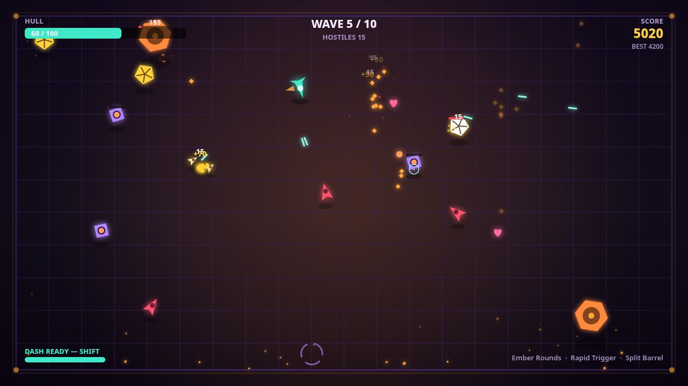

# Emberfall Arena

An original twin-stick arena survival shooter for the browser, written in plain
JavaScript — no engine, no libraries, no image or sound assets. Every shape is drawn
in code on a canvas, and every sound and note of music is synthesised with WebAudio.



## The game

Embers are falling on a sky-arena, and everything that falls is hungry. Pilot a small
ember-skimmer through **10 waves** of enemies — chasing **Drifters**, bolt-spitting
**Spitters**, armoured **Brutes** and **Splitters** that burst into Minis when they
die — choosing one of three upgrade cards after every wave: split barrels, piercing
lance rounds, crit sights, phase boots and more, stacked into a build of your own.
In wave 10 the **Hollow Warden** descends: a spiked boss who breathes radial bursts
of fire, telegraphs and charges, and calls Drifters to him as he weakens. Break him
and the emberfall ends. Let your hull reach zero and the arena goes dark.

## How to play

| Input | Action |
|---|---|
| WASD / Arrow keys | Move |
| Mouse | Aim |
| Hold left mouse / Space | Shoot |
| Shift / Right-click | Dash (brief invulnerability, recharges) |
| 1 / 2 / 3 or click | Choose an upgrade card between waves |
| P / Esc | Pause |
| M | Mute |

Collect the ember motes enemies drop for score (your magnet pulls them in) and the
pink hearts for hull. The HUD shows your hull, the wave, hostiles remaining, your
score, your dash charge and your current build; the Warden gets a health bar of his
own. Both endings — victory and game over — report your score, kills and time, and
restart on Enter or a click.

## Run it

Requires Node.js 22.18 or later (for the local server only — the game itself is
static files and plays offline from `game/` under any static file server):

```sh
node serve.ts          # serves game/ at http://localhost:8080
```

Hand the entry in the way the make.fun grader does:

```sh
mkdir -p out && MAKEFUN_OUTPUT_DIR=out node main.ts   # writes out/dossier.json
```

## Layout

- `game/index.html` — the page; loads `game/src/main.js` as a module.
- `game/src/` — the game, one job per file: `config` (tuning and palette), `random`
  (seeded RNG), `world` (the fixed-step simulation and collisions), `player`,
  `enemies` (the five kinds and the Warden), `projectiles`, `pickups`, `particles`,
  `waves` (the ten-wave director), `upgrades` (the cards), `audio` (synth sound and
  music), `input`, `render` (the canvas scene), `ui` (HUD and screens), `shots`
  (the deterministic screenshot scenes and their autopilot), `main` (the loop).
- `main.ts` — copies `game/` and `screenshots/` to the output and writes the dossier.
- `vendor/makefun-game.ts` — the make.fun dossier library, copied unchanged.
- `screenshots/` — four real renders of the game's own code, staged by `shots.js`.

The simulation is deterministic for a given `?seed=N`, and `world.js` and everything
it imports run under Node with no DOM, which is how the game is smoke-tested headless:
an autopilot that wins some seeds and dies on others, a passive player who always
dies, and a boss who can always be killed.

## License

MIT — see `LICENSE`.
